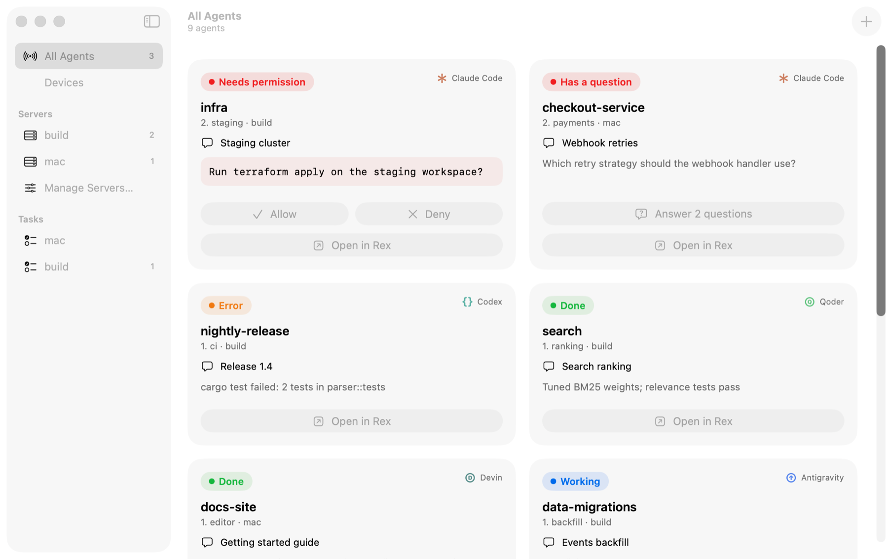
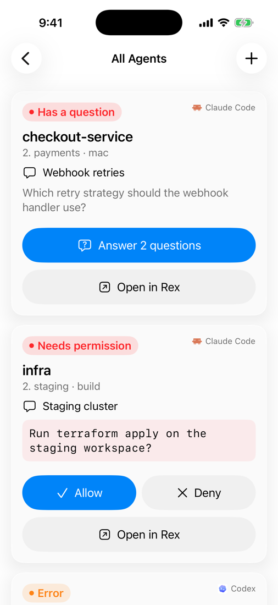
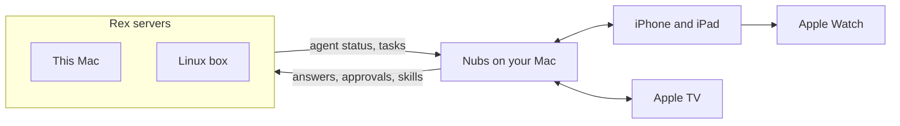
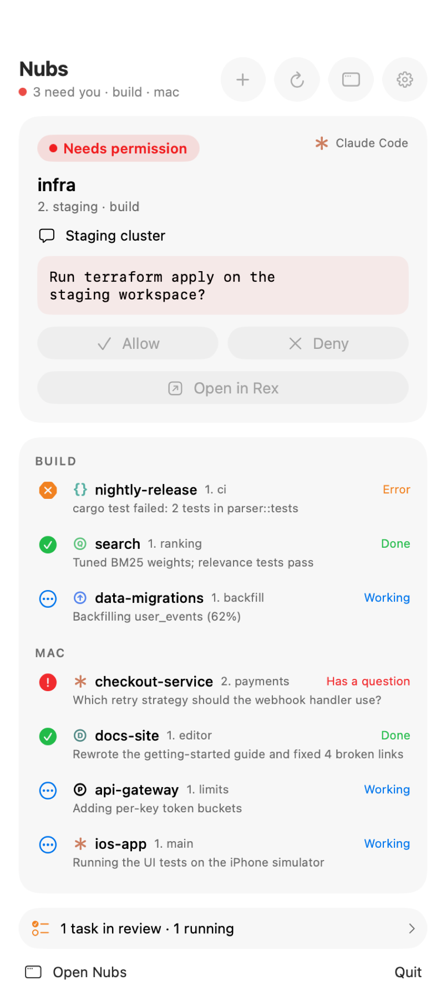
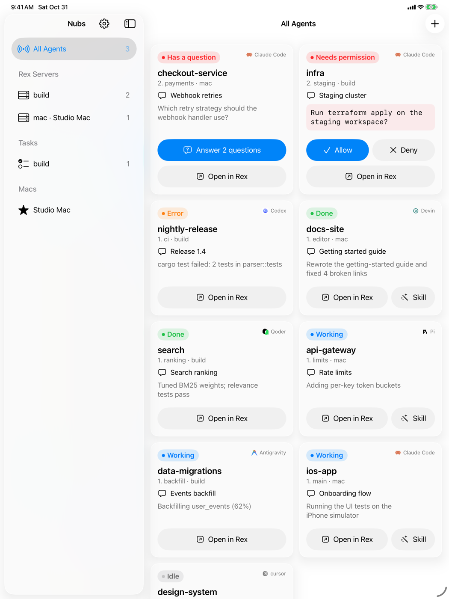
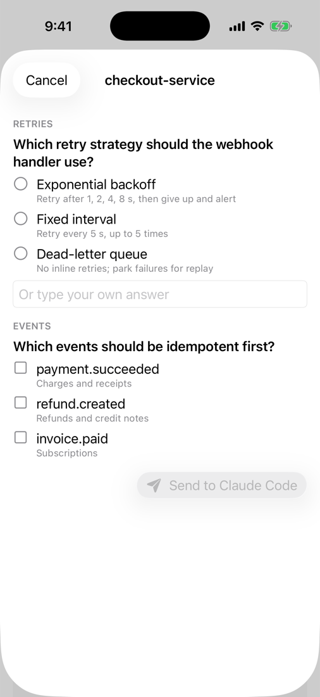
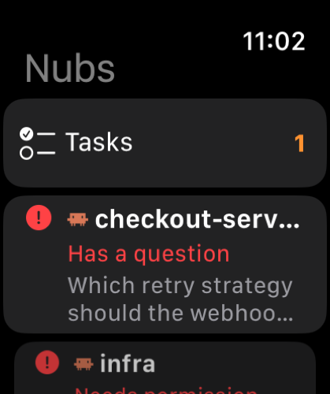
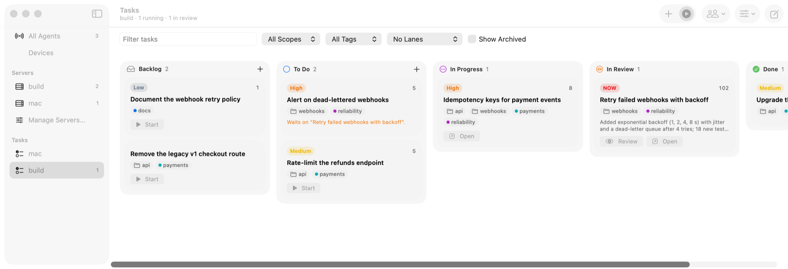
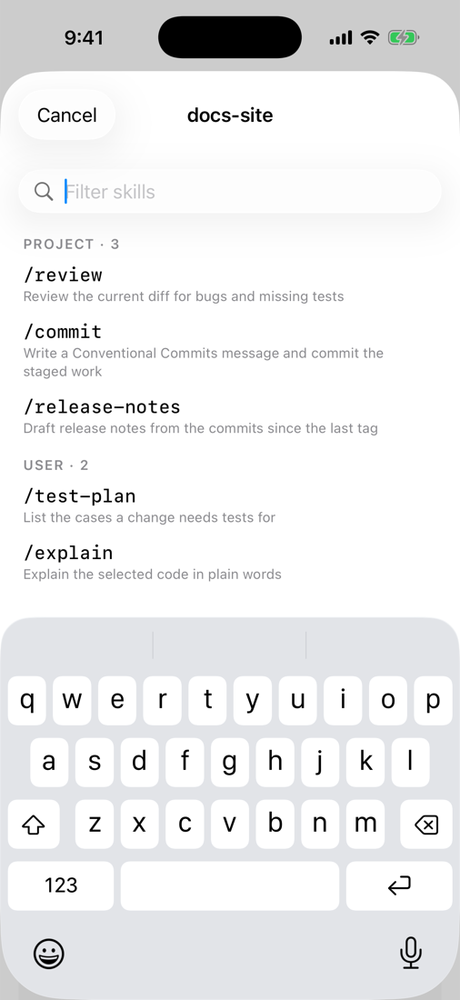
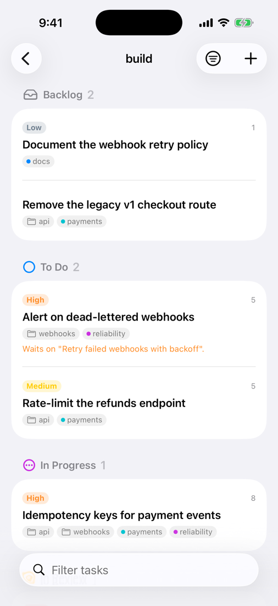

# Nubs

**Keep your coding agents working around the clock, and drop in from any Apple device.**

[](https://github.com/good-banana/nubs/releases/latest)
[](LICENSE)


<p align="center">
  <picture>
    <source media="(prefers-color-scheme: dark)" srcset="screenshots/mac-window-dark.png">
    
  </picture>
  <picture>
    <source media="(prefers-color-scheme: dark)" srcset="screenshots/iphone-agents-dark.png">
    
  </picture>
</p>

Nubs keeps the coding agents you run in [Rex](https://www.superlogical.com/rex) moving: Claude Code, Codex,
Devin, Cursor, Antigravity, Qoder and Pi, across every project and every Rex server, including headless Linux
boxes. Agents work through a shared task board on their own, each in its own git worktree, starting the next task
as soon as there's room. When one needs you, you know right away, and you answer it, allow it or review its work
from your Mac's menu bar, your iPhone or iPad, your Apple Watch, or the Apple TV across the room. Nubs takes what
Rex does for one terminal and puts it on every device you own.

> A community project, not affiliated with Superlogical. Rex is in beta and changes weekly, so a Rex update can
> break something here before Nubs catches up.

## How it works

Each Rex server runs a small watcher that reports what every agent pane is doing, and, if you want them, a tasks
engine that keeps work queued and running. The Nubs Mac app gathers it all, answers for your agents in their own
terminals, and serves your iPhone, iPad, Apple Watch and Apple TV over your network.



## Highlights

### Every agent, most urgent first

Blocked, failed, done, working and idle agents from all your Rex servers, sorted by what needs you. In the menu
bar, a desktop widget, Home and Lock Screen widgets, watch complications and a full-screen grid on Apple TV.

<p align="center">
  <picture>
    <source media="(prefers-color-scheme: dark)" srcset="screenshots/mac-panel-dark.png">
    
  </picture>
  <picture>
    <source media="(prefers-color-scheme: dark)" srcset="screenshots/ipad-dark.png">
    
  </picture>
</p>

### Answer and allow from anywhere

An agent waiting on a question list or a permission prompt doesn't wait for you to get back to your desk. Pick
the answers or tap Allow on your phone or wrist, and Nubs types them into the agent's own terminal, checking
first that it's still asking the same thing.

<p align="center">
  <picture>
    <source media="(prefers-color-scheme: dark)" srcset="screenshots/iphone-answer-dark.png">
    
  </picture>
  
</p>

### Tasks that keep running

A board of work per Rex server: priorities, dependencies, scopes and tags, and file claims so agents running in
parallel don't collide. Runs start on their own in a git worktree, wait for your review, and merge when you
approve, from the Mac or the phone. The server does the git work itself, so a headless Linux box keeps going
while your laptop sleeps.

<p align="center">
  <picture>
    <source media="(prefers-color-scheme: dark)" srcset="screenshots/mac-tasks-dark.png">
    
  </picture>
</p>

### Every agent you use

Claude Code, Codex, Devin, Cursor, Antigravity, Qoder and Pi. Send any of their skills and slash commands, with
arguments, queued while the agent works where it can queue them; start a new agent session in any folder; and jump to an agent's pane in
Rex with one click or tap.

<p align="center">
  <picture>
    <source media="(prefers-color-scheme: dark)" srcset="screenshots/iphone-skills-dark.png">
    
  </picture>
  <picture>
    <source media="(prefers-color-scheme: dark)" srcset="screenshots/iphone-tasks-dark.png">
    
  </picture>
</p>

## Install

Download **[Nubs.dmg](https://github.com/good-banana/nubs/releases/latest/download/Nubs.dmg)**, open it and drag
Nubs to Applications. To install the app together with the tasks engine and the agent hooks below, run this in
Terminal instead:

```sh
curl -fsSL https://github.com/good-banana/nubs/releases/latest/download/install.sh | sh
```

On a Mac this installs `Nubs.app` in `~/Applications` (or updates the one in `/Applications`, if you installed
from the DMG), the tasks engine for this Mac's Rex server, the Claude
Code hook that lets Nubs answer Claude's question lists, and, if you use Cursor, the hook that reports Cursor's
status to Rex. On Linux it installs the tasks engine for that machine's
Rex server. Every download is checked against the release's `SHA256SUMS`.

**Requirements:** [Rex](https://www.superlogical.com/rex) with **Remote Control** on in the Rex app's settings, and
macOS 26.

<details>
<summary>Options and what the installer changes</summary>

Options go after `sh -s --`, for example `curl -fsSL …/install.sh | sh -s -- --systemd`:

| Option | Effect |
| --- | --- |
| `--version vX.Y.Z` | Install that release instead of the latest. |
| `--systemd` | Linux: also a systemd user service that keeps task runs moving when no Mac watches the server. |
| `--config-dir DIR`, `--server SOCKET` | A shared Linux server: run as root with `--config-dir /var/lib/rex/.config/rex --server /run/rex/server.sock`. |
| `--no-hooks` | Mac: leave `~/.claude/settings.json` and `~/.cursor/hooks.json` alone. |
| `--dry-run` | Print what it would do, and change nothing. |
| `--uninstall` | Remove everything it installed (below). |

What it changes:

- `~/Applications/Nubs.app` (Mac), signed and notarized, with its desktop widget, or the copy in
  `/Applications` if you installed from the DMG.
- `nubs-tasks.lua` and `nubs-tasks-pump.lua` beside the Rex server's `init.lua` (`~/.config/rex`), and
  `require("nubs-tasks")` added to `init.lua` if it isn't there. It checks the config with `rex config check`,
  putting everything back if Rex can't load it, then runs `rex config reload`. Symlinked dotfiles stay symlinks.
- Mac: `~/.local/share/nubs/hooks/`, with entries in `~/.claude/settings.json` and, when `~/.cursor` exists,
  `~/.cursor/hooks.json`. The first time it changes either file, the original is kept beside it with a
  `.nubs-backup` suffix. This needs `jq`, which macOS 15 and later include.

Run it as yourself on a Mac, not with `sudo`. If the tasks engine can't be installed (Rex isn't installed yet, say),
the app and the hook still are, and the installer says what went wrong.

</details>

## iPhone, iPad, Apple Watch and Apple TV

The apps for iPhone and iPad (iOS 17), Apple Watch (watchOS 10) and Apple TV (tvOS 17) are coming to TestFlight.
This page will link to them when they're ready.

## Set up your devices

- **Remote Rex servers:** add them in the Nubs window's **Manage Servers…**. They're the hosts your Rex app
  already connects to.
- **iPhone and iPad:** scan the QR code on the window's **Devices** page. The Mac and the phone need to be on the
  same network (or the same tailnet).
- **Apple Watch:** nothing to do. It uses the Macs your iPhone is paired with.
- **Apple TV:** pick your Mac in the TV app, then click **Allow** on the Mac's Devices page.
- **A Linux server for Tasks:** run the installer there, with `--systemd` if no Mac watches it.

## FAQ

<details>
<summary>No agents show up.</summary>

Check that Rex is running and that **Remote Control** is on in the Rex app's settings. Agents appear once they
report their status to Rex: Claude Code 2.1.310 or later, Devin, Antigravity and Pi do it themselves; Codex does
through the hook Rex installs for it, which Codex must trust; Cursor through the Nubs hook the installer adds.
</details>

<details>
<summary>A server's agents are greyed out.</summary>

Nubs hasn't heard from that server's watcher in a while: the machine is asleep or offline, or Rex stopped there.
</details>

<details>
<summary>Claude asks several questions but Nubs shows only the first.</summary>

Rex's status carries only the first question; the rest come from the `claude-rex-questions` hook, which the
installer adds. Run it again without `--no-hooks`.
</details>

<details>
<summary>My iPhone can't reach the Mac.</summary>

Both need to be on the same network, and the Mac must be awake with Nubs running. Cloudflare WARP and similar
VPNs on the Mac can block local traffic: with WARP, `warp-cli override local-network allow` lets it through
until WARP reconnects.
</details>

<details>
<summary>Tasks say the engine isn't installed.</summary>

Click **Install** on the server's Tasks page (this Mac), or run the installer on that server's machine: Rex only
reloads its config on the machine that hosts it.
</details>

## Uninstall

```sh
curl -fsSL https://github.com/good-banana/nubs/releases/latest/download/install.sh | sh -s -- --uninstall
```

It removes the app, its login item, the hooks, the tasks engine and its `init.lua` line, and the systemd service,
then asks whether to delete your task history and agent snapshots too (`--purge` or `--keep-state` answer up
front).

## Feedback

Found a bug or want something? [Open an issue](https://github.com/good-banana/nubs/issues).

## Credits and license

Based on [Rex Radar](https://github.com/hecspc/rex-radar) by Hector Sanchez Pajares. MIT licensed, see
[LICENSE](LICENSE). Rex is made by [Superlogical](https://www.superlogical.com/rex).
